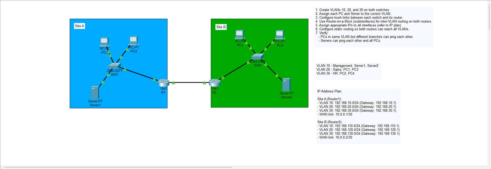
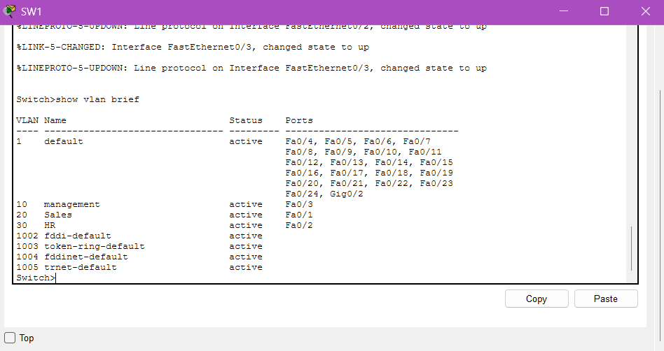
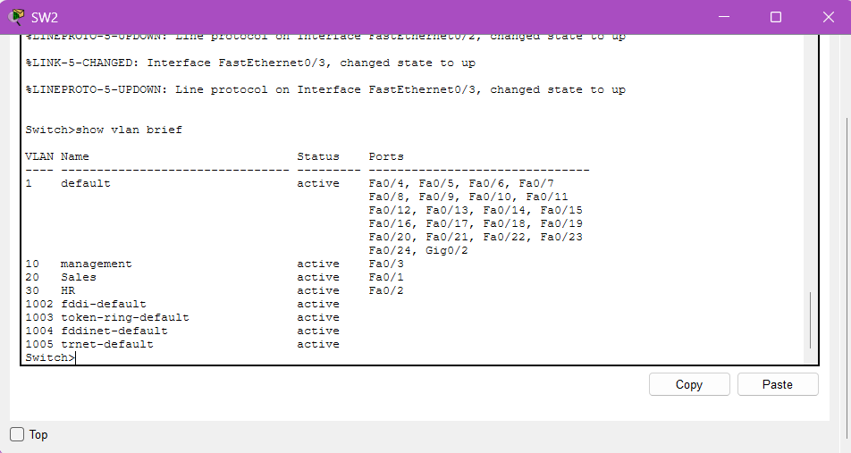
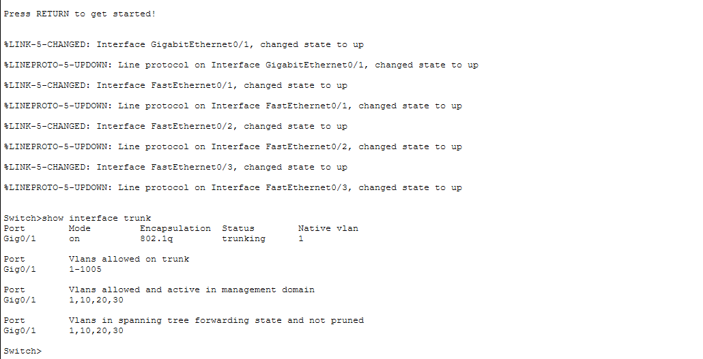
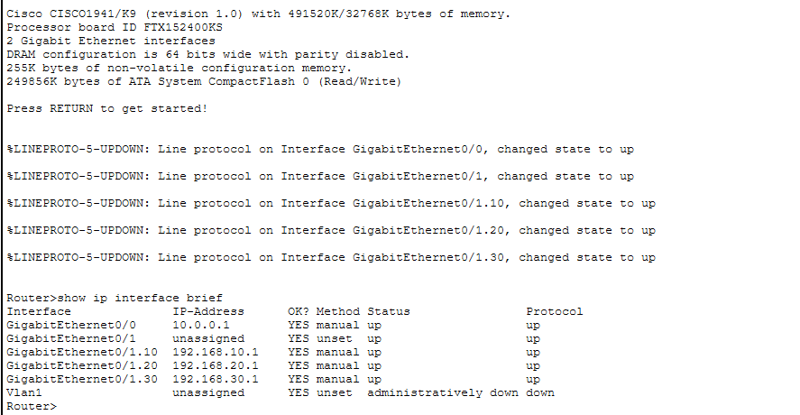
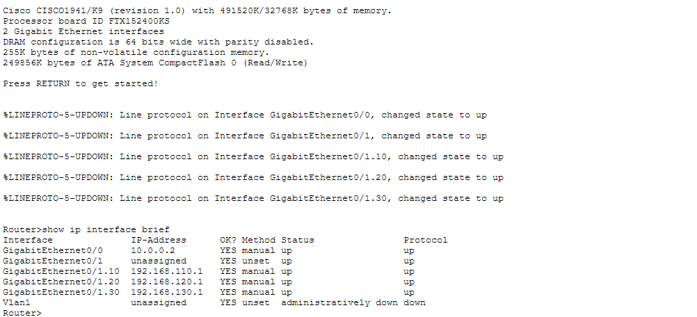
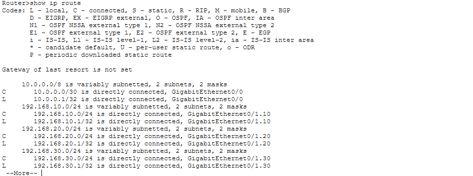
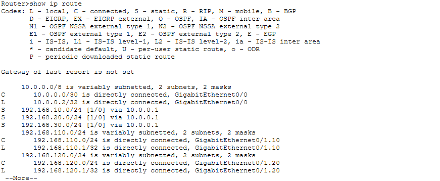
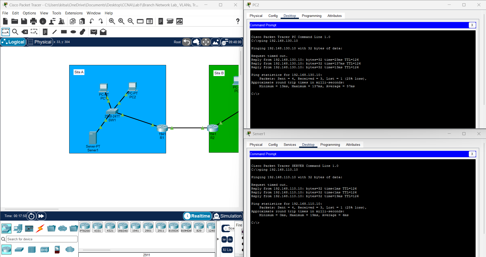

<div align="center">

```
███╗   ██╗███████╗████████╗██╗    ██╗ ██████╗ ██████╗ ██╗  ██╗
████╗  ██║██╔════╝╚══██╔══╝██║    ██║██╔═══██╗██╔══██╗██║ ██╔╝
██╔██╗ ██║█████╗     ██║   ██║ █╗ ██║██║   ██║██████╔╝█████╔╝ 
██║╚██╗██║██╔══╝     ██║   ██║███╗██║██║   ██║██╔══██╗██╔═██╗ 
██║ ╚████║███████╗   ██║   ╚███╔███╔╝╚██████╔╝██║  ██║██║  ██╗
╚═╝  ╚═══╝╚══════╝   ╚═╝    ╚══╝╚══╝  ╚═════╝ ╚═╝  ╚═╝╚═╝  ╚═╝
   M U L T I - B R A N C H   S E G M E N T A T I O N   L A B
```

**Lab-01 — Enterprise segmentation, inter-VLAN routing, and deterministic WAN routing**

[](https://www.cisco.com/)
[](https://www.netacad.com/courses/packet-tracer)
[](#)
[](../LICENSE)

</div>

---

## `~$ Abstract`

This lab documents the design, implementation, and validation of a **dual-branch enterprise network**. The
architecture enforces departmental segmentation with Layer 2 VLANs, establishes Layer 3 boundaries through
Inter-VLAN Routing (Router-on-a-Stick), and provides deterministic inter-branch connectivity across a
dedicated point-to-point WAN link using IPv4 static routing.

It is written as a **design artifact**, not just a build log: each decision is paired with its security
rationale and trade-off, the operational state is validated layer by layer, and the known limitations are
stated openly alongside the path to an enterprise-ready design.

---

## `~$ cat brief.md`

**Objective:** Segment each branch into isolated broadcast domains, route between them through a controlled
Layer 3 boundary, and connect both sites over a minimal, predictable transit network, while documenting the
security posture and the gaps that remain before production use.

**Environment:** Cisco Packet Tracer simulation. No production equipment or live traffic involved.

| Layer | Component | Role |
|---|---|---|
| L2 | Cisco 2960 switch (per site) | VLAN segmentation, 802.1Q trunking |
| L3 | Cisco 1941 router (per site) | Inter-VLAN routing via subinterfaces, default gateway |
| WAN | `10.0.0.0/30` point-to-point | Router-to-router transit, static routes |

---

## `~$ cat topology.md`

Two symmetrical branch sites (Site A and Site B) keep the design consistent and administration simple. Each
site has one switch for the Layer 2 domain and one router acting as the Layer 3 boundary and default gateway.
A `/30` transit subnet conserves address space and limits the broadcast domain on the WAN link to exactly the
two router interfaces.

<div align="center">
  
  <br>
  <sub><b>Fig. 1</b> — Dual-branch topology: Site A and Site B connected over a point-to-point /30 WAN link</sub>
</div>

---

## `~$ cat addressing.md`

| Site | VLAN | Name | Subnet | Gateway (L3 interface) |
|:--|:--|:--|:--|:--|
| **Site A** | 10 | Management | `192.168.10.0/24` | `192.168.10.1` |
| | 20 | Sales | `192.168.20.0/24` | `192.168.20.1` |
| | 30 | HR | `192.168.30.0/24` | `192.168.30.1` |
| **Site B** | 10 | Management | `192.168.110.0/24` | `192.168.110.1` |
| | 20 | Sales | `192.168.120.0/24` | `192.168.120.1` |
| | 30 | HR | `192.168.130.0/24` | `192.168.130.1` |
| **WAN** | — | Transit | `10.0.0.0/30` | Router-to-router |

The addressing plan keeps Site B's third octet at Site A's value plus 100, so a host's site and department are
readable straight from its address, which simplifies troubleshooting, summarisation, and ACL authoring later.

---

## `~$ cat segmentation.md`

> The primary defense against lateral movement is segmentation.

| VLAN | Name | Contents | Security intent |
|:--|:--|:--|:--|
| **10** | Management | Servers, critical infrastructure | Isolates the management plane from user-plane traffic |
| **20** | Sales | User endpoints | User data plane |
| **30** | HR | User endpoints | Isolated from Sales to protect sensitive employee data |

### Layer 2 evidence — VLAN database on both switches

<div align="center">
  
  
  <br>
  <sub><b>Fig. 2</b> — <code>show vlan brief</code> on Site A (left) and Site B (right): VLANs 10, 20, 30 defined with access ports assigned</sub>
</div>

### Trunk configuration (802.1Q)

Links between switches and routers are 802.1Q trunks carrying all three VLANs to the router subinterfaces.

<div align="center">
  
  <br>
  <sub><b>Fig. 3</b> — <code>show interfaces trunk</code>: trunk mode, encapsulation, native VLAN, and allowed VLANs</sub>
</div>

> **Architectural note:** In this lab the native VLAN remains the default (VLAN 1) and trunk negotiation is
> not disabled. This is acceptable for a simulation but **not for production**. See the
> [hardening backlog](#-cat-hardening-backlogmd) below.

---

## `~$ cat routing.md`

### Inter-VLAN routing: Router-on-a-Stick

Each router terminates the switch trunk with one 802.1Q subinterface per VLAN and serves as the default
gateway for every endpoint at its site.

**Design trade-off:** Cost-effective for small branches, but the single physical interface is both a
**bottleneck** and a **single point of failure**. It is not suited to high-throughput core designs.

### WAN routing: static routes

The control plane deliberately uses static routes instead of OSPF or BGP.

**Security rationale:** Static routing removes routing-protocol attack surface (for example OSPF neighbor
spoofing or rogue route advertisements) and removes protocol overhead. Every inter-site path is
administrator-defined and fully predictable.

**Trade-off:** No automatic failover and no convergence. A link or next-hop failure requires manual
intervention, which is why dynamic routing with authentication is on the roadmap below.

### Layer 3 evidence: interfaces and routing tables

<div align="center">
  
  
  <br>
  <sub><b>Fig. 4</b> — <code>show ip interface brief</code> on R1 (left) and R2 (right): subinterfaces and WAN interface up/up</sub>
</div>

<br>

<div align="center">
  
  
  <br>
  <sub><b>Fig. 5</b> — <code>show ip route</code> on R1 (left) and R2 (right): connected networks plus static routes to the remote branch</sub>
</div>

---

## `~$ cat design-decisions.md`

| Decision | Rationale | Trade-off / limitation |
|---|---|---|
| Per-department VLANs | Contain broadcast domains and limit lateral movement | Unrestricted inter-VLAN routing until ACLs are applied |
| Dedicated Management VLAN | Keeps servers off the user plane | Needs ACL enforcement to be meaningful |
| Router-on-a-Stick | Low cost, simple, fits a small branch | Bottleneck and single point of failure |
| `/30` WAN transit | Conserves addresses, minimal broadcast domain | Point-to-point only; no room for more peers |
| Static routing | No protocol attack surface, deterministic paths | No failover, manual scaling |
| Symmetrical site design | Consistent, easy to operate and audit | Assumes identical branch requirements |

---

## `~$ cat verification.md`

Validation followed the **OSI troubleshooting model**, bottom-up, so each layer is proven before the next
is trusted.

| # | Layer | Test | Expected result |
|:--|:--|:--|:--|
| 1 | L2 | Endpoints ARP for their default gateways | Gateway MAC resolved |
| 2 | L3 | Sales PC reaches the Management server at the same site | Inter-VLAN routing works |
| 3 | L3 / WAN | Site A PC reaches Site B PC across the static routes | End-to-end connectivity over the WAN |

<div align="center">
  
  <br>
  <sub><b>Fig. 6</b> — Connectivity verification: intra-site inter-VLAN and cross-site WAN reachability</sub>
</div>

**Observation:** The first ICMP request in a test fails while the routers and hosts populate their ARP caches
for the next-hop address. Subsequent requests complete with 0% packet loss. This is expected cold-cache
behavior, not a fault.

---

## `~$ cat hardening-backlog.md`

The current build proves connectivity and segmentation. It is **not yet least-privilege**. The items below are
the identified gaps, listed by priority, with the production-hardening intent for each.

| Priority | Gap | Risk | Planned control | Status |
|:--|:--|:--|:--|:--|
| High | No ACLs between VLANs | Any VLAN can reach any other (Sales to HR) | Extended ACLs on router subinterfaces, least-privilege | ⬜ |
| High | Native VLAN is VLAN 1 | VLAN hopping (double tagging) | Move native VLAN to an unused blackhole VLAN | ⬜ |
| High | DTP not disabled | Unauthorized trunk negotiation | Static trunks with `switchport nonegotiate` | ⬜ |
| Medium | Single router per site | Single point of failure | L3 switching (SVIs) with HSRP/VRRP | ⬜ |
| Medium | Static WAN routing | No failover or convergence | OSPF or BGP with neighbor authentication | ⬜ |
| Medium | Unused ports not locked down | Rogue device access | Shutdown unused ports, port security | ⬜ |

**Illustrative trunk hardening (planned, not yet applied in this lab):**

```
interface GigabitEthernet0/1
 switchport mode trunk
 switchport nonegotiate
 switchport trunk native vlan 999
 switchport trunk allowed vlan 10,20,30
```

**Target policy intent for inter-VLAN ACLs:**

- Sales **cannot** reach HR
- Sales and HR **can** reach only the specific Management services they need
- Management is not reachable by default from the user VLANs
- Everything else is denied and logged

---

## `~$ cat roadmap.md`

| Phase | Enhancement | Outcome |
|:--|:--|:--|
| 1 | Extended ACLs per VLAN | Enforce least-privilege segmentation |
| 2 | Trunk hardening and port security | Close VLAN hopping and rogue-device paths |
| 3 | L3 switching with HSRP/VRRP | Remove the router-on-a-stick single point of failure |
| 4 | OSPF/BGP with authentication | Rapid convergence, multi-site scalability |

---

## `~$ cat structure.md`

```
Network-Engineering/
└── Lab-01-VLANs-and-Static-Routing/
    ├── Assets/
    │   ├── Images/
    │   ├── lab-topology.png               # Fig. 1  Topology
    │   ├── Sw1-Vlan-Brief.png             # Fig. 2  Site A VLAN database
    │   ├── Sw2-Vlan-Brief.png             # Fig. 2  Site B VLAN database
    │   ├── Interface-trunk.png            # Fig. 3  Trunk verification
    │   ├── R1-Ip-brief.png                # Fig. 4  Site A interfaces
    │   ├── R2-Ip-brief.png                # Fig. 4  Site B interfaces
    │   ├── Ip-Route1.png                  # Fig. 5  Site A routing table
    │   ├── Ip-Route2.png                  # Fig. 5  Site B routing table
    │   └── Communication-Verification.png # Fig. 6  End-to-end tests
    ├── *.pkt                              # Packet Tracer simulation file
    └── README.md                          # This file
```

---

## `~$ cat artifacts.md`

| Artifact | Description |
|---|---|
| Packet Tracer file (`.pkt`) | Functional Cisco Packet Tracer simulation of the full topology |
| `Assets/` | Verification screenshots referenced throughout this document |
| `/Configurations` | Sanitized `running-config` outputs for audit and rollback |

---

## `~$ cat skills.md`

| Domain | Demonstrated |
|---|---|
| **Switching** | VLAN design, 802.1Q trunking, access port assignment |
| **Routing** | Router-on-a-Stick, subinterface design, static routing, transit addressing |
| **Addressing** | Subnet planning, `/30` point-to-point design, readable address schemes |
| **Security architecture** | Segmentation strategy, VLAN-hopping awareness, routing attack surface reduction |
| **Validation** | OSI layered troubleshooting, ARP/ICMP analysis |
| **Engineering judgment** | Documented trade-offs, honest limitations, prioritized hardening roadmap |

---

## `~$ contact --info`

[](#)
[](https://github.com/vetementsvmnts)

---

<div align="center">

*This lab was built entirely in a simulated environment (Cisco Packet Tracer) for educational and portfolio
purposes. No production systems, live traffic, or unauthorized targets were involved.*

</div>
